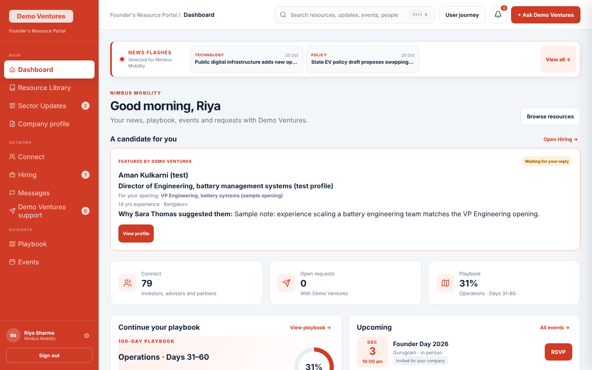
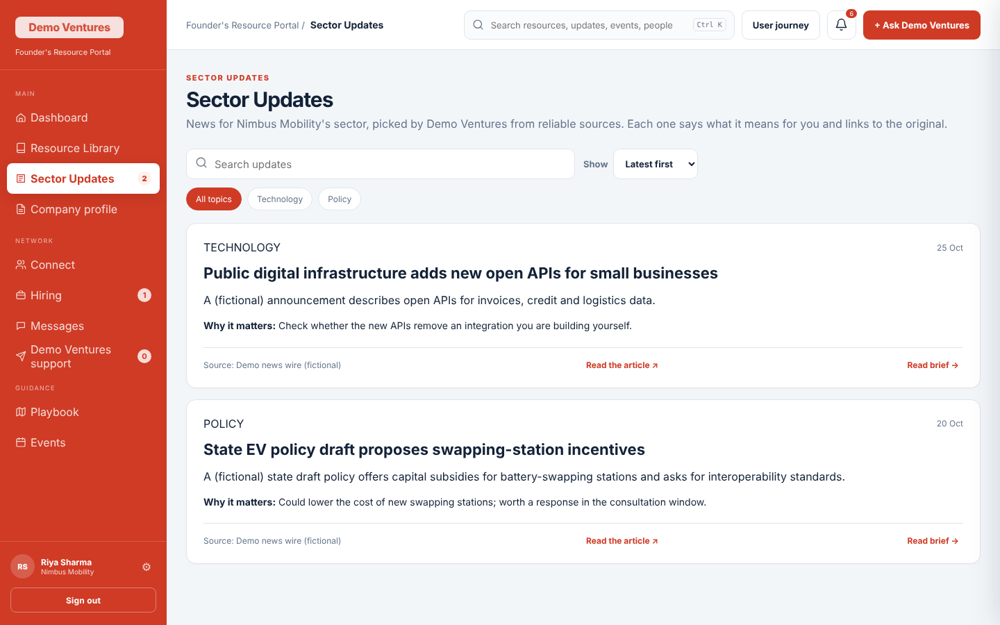
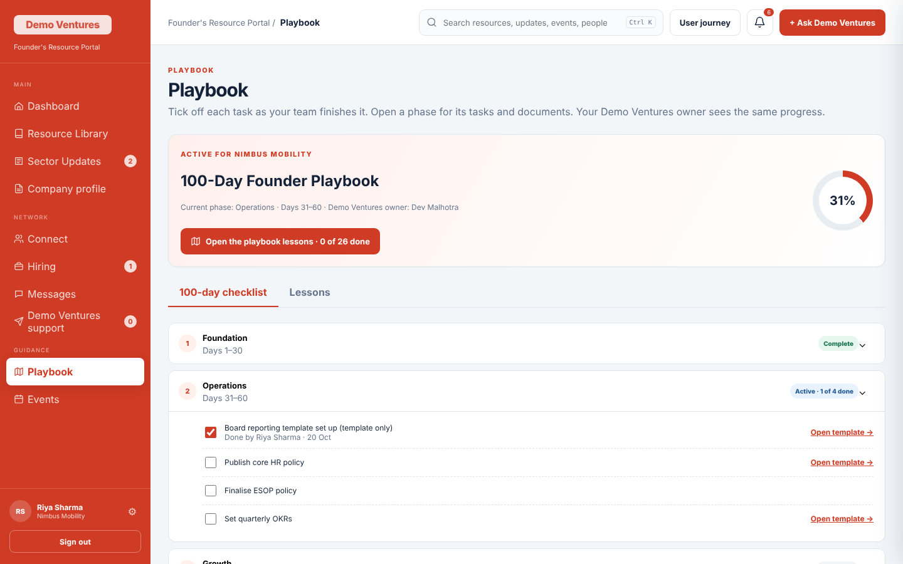
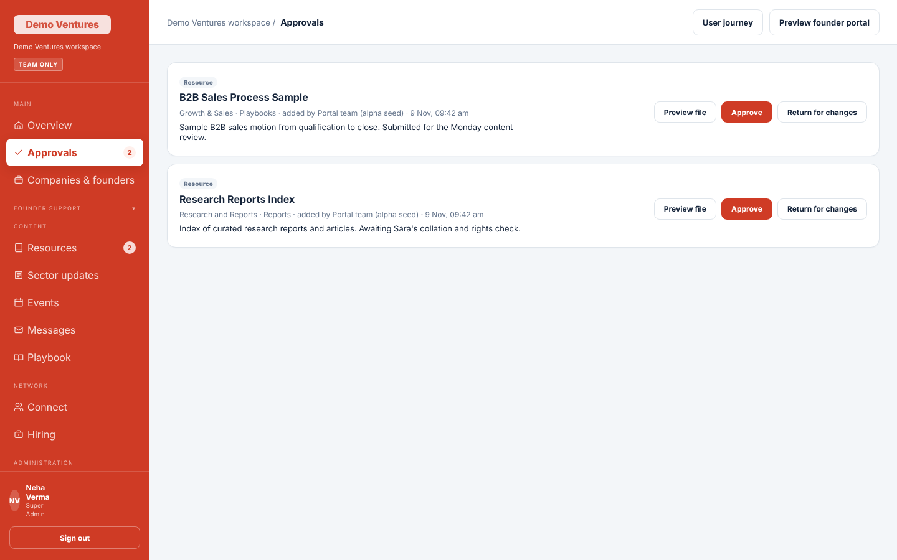
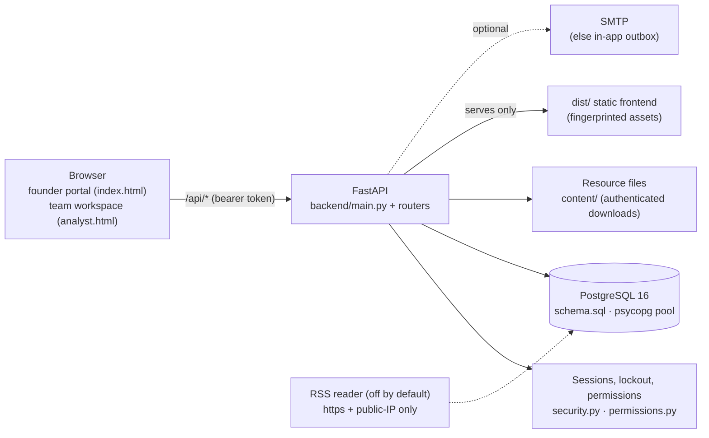

# Founder's Resource Portal

**A secure, company-centred support portal for venture-backed founders — sector updates, an approved resource library, a 100-day playbook, introductions, hiring help and one trackable request thread with the fund team — with a three-tier staff workspace, an approval layer and a full audit trail.**

[](https://github.com/Akshatb848/founder-resource-portal/actions/workflows/ci.yml)


> Built by Akshat Banga during an internship at YourNest Venture Capital; this public version contains no YourNest data, branding or documents.
>
> Every company, person, email address, investor and news item in this repository is **fictional demo data** (fund shown as *Demo Ventures (fictional)*).



## Why it exists

After a venture round, founders get help from their investor through scattered email, WhatsApp and shared drives: nobody knows which request is open, who owns it, or which template is the approved one. This portal gives each portfolio company **one place** for everything the fund offers, and gives the fund team **one workspace** to run it — with permissions, approvals and an audit trail so that nothing reaches a founder unreviewed.

## What it does (plain English)

**For founders** — sign in and see a dashboard for *your* company:

- **Sector Updates** picked for your sector, each saying *why it matters to you*, with a link to the source.
- **Resource Library** of approved templates (fundraising checklist, financial model, OKRs, sales pipeline, hiring…).
- **100-Day Playbook**: a checklist across four phases plus short lessons; progress is shared with your fund owner.
- **Connect**: a directory of investors, service partners, peer founders and the fund team — ask for an introduction.
- **Hiring**: candidate profiles the fund team features for your open roles, and a public "express interest" page per opening.
- **Support**: one request thread with an owner, status and priority you can follow; **Events** with RSVP and calendar files.
- **Company profile**: governance and compliance details with change history and a PDF export.

**For the fund team** — a separate workspace with three tiers (Super Admin, Admins, Analysts): approvals, companies & founders (single-use invite links), the request queue, content (resources, sector updates, events, Connect, hiring, lessons), founder activity, messages/outbox and a full audit trail.

| Sector updates | 100-day playbook | Team approvals |
|---|---|---|
|  |  |  |

## Roles and permissions

| Role | Sees | Can do |
|---|---|---|
| **Super Admin** (exactly one, enforced in the DB) | The whole portfolio | Everything; **the only approver**; adds Admins; full audit trail; hands the role over |
| **Admin** | Their own companies (and their analysts' companies) | Invite founders, assign the team, manage analysts, playbooks, requests, candidate approval |
| **Analyst** | Their assigned companies | Day-to-day support: requests, playbooks, founder activity; adds content that **waits for approval** |
| **Founder** | Their own company only | Use the founder portal |

27 named permissions live in [`backend/permissions.py`](backend/permissions.py), scoped to *all* or *assigned* companies and synced to the database at start-up. Every API route checks a permission, never a role name. Full matrix: [`docs/FEATURES.md`](docs/FEATURES.md).

## Architecture



- **Security boundary:** only `dist/` is served; source, `.env`, docs and `.git` return 404. bcrypt passwords, revocable DB sessions, rate-limited sign-in, CSP and other security headers. See [`SECURITY.md`](SECURITY.md).
- **Approval layer:** content from Admins/Analysts is stored as *pending*; founders' queries only return approved rows.
- **Switches:** sector-news feed reading (`NEWS_FETCH_ENABLED`, `NEWS_SUGGESTIONS_ENABLED`) and one-time-code sign-in (`OTP_SIGNIN_ENABLED`) are built but **off by default**. Without SMTP, all email waits in the workspace outbox.

## Quick start

### Option A — Docker Compose

```bash
docker compose up --build        # Postgres 16 + API, schema and fictional demo data loaded
open http://127.0.0.1:8000
```

### Option B — local Python + PostgreSQL (Linux/macOS)

```bash
./scripts/pg_local.sh start                     # optional: throw-away Postgres on :5433 (needs initdb/pg_ctl on PATH)
cp backend/.env.example backend/.env            # set PG_PORT=5433 (or your own database) — values are placeholders
./scripts/run_local.sh                          # venv, deps, dist/, schema + demo data, API on http://127.0.0.1:8000
```

Windows users can run the same steps by hand (`python -m backend.seed`, then `uvicorn backend.main:app`); `scripts/sync_dist.ps1` refreshes `dist/`.

### Demo logins (password `demo1234` for every account)

| Role | Email | Notes |
|---|---|---|
| Founder | `riya@nimbus.demo` | Riya Sharma, Nimbus Mobility (fictional) |
| Super Admin | `superadmin@team.demo` | Neha Verma |
| Admin | `manager@team.demo` | Dev Malhotra — Nimbus Mobility, Ledgerly Fintech, Kirana Cloud |
| Analyst | `analyst@team.demo` | Sara Thomas — Nimbus Mobility, Ledgerly Fintech |
| Second Admin / analysts | `admin2@team.demo`, `analyst2…4@team.demo` | Tara Menon's team: Orbit Health, Greenrow Agritech, Ringly |
| Other founders | `kabir@ledgerly.demo`, `meher@orbithealth.demo`, `pooja@ringly.demo`, … | One or two per demo company |

These are public demo credentials for a local database; never load the demo seed into a database real people use.

## Tests

```bash
./scripts/test.sh                                   # ruff + unit tests (no database needed)
FP_TEST_DB=1 PG_HOST=127.0.0.1 PG_PORT=5433 PG_DB=founder_portal_test \
  PG_USER=fp_local PG_PASSWORD=change-me ./scripts/test.sh   # + integration tests against a seeded Postgres
```

- **Unit (60):** permission model consistency and scoping, feed-URL safety (SSRF), news scoring, files that must never be served, security headers, XLSX tracker import parsing, company-profile rules, `dist/` freshness.
- **Integration (9):** seeds Postgres, then checks login, the company-specific founder dashboard, role-based access across the three tiers, the approval flow, news suggestions being off, and session revocation.
- **Browser checks (`tests/e2e`, Playwright, optional):** mobile layout, Connect search/paging, public pages, the tracker upload and a crawl that clicks every button — run against a local demo server.
- **CI** ([`.github/workflows/ci.yml`](.github/workflows/ci.yml)): ruff, `dist/` sync check, unit tests and integration tests against a Postgres 16 service — no secrets needed.

## Project structure

```
index.html, analyst.html, careers.html   founder portal, team workspace, public "express interest" page
*.js, *.css (root)                       frontend source — vanilla HTML/CSS/JS, no build step
dist/                                    the only folder the API serves (scripts/sync_dist.py fingerprints assets)
backend/                                 FastAPI app, schema.sql, permissions, seed + fictional demo data
backend/scripts/                         content builder, demo-data importers, provisioning and maintenance
content/alpha/                           generated generic templates (DOCX/XLSX)
tests/                                   unit, integration and Playwright browser checks
scripts/                                 run_local.sh, pg_local.sh, test.sh, sync_dist.py (+ .ps1)
docs/                                    FEATURES.md (roles, permission matrix), screenshots
```

## Tech stack

Python · FastAPI · Uvicorn · PostgreSQL (psycopg 3 + pool) · Pydantic · bcrypt · defusedxml · vanilla HTML/CSS/JavaScript · openpyxl / python-docx (template generation) · pytest · Playwright · ruff · GitHub Actions · Docker Compose

## Limitations and honest notes

- **Alpha.** Built for a small pilot; no load testing, no horizontal scaling, single-process scheduler.
- Sign-in is email + password (Google sign-in is a placeholder; one-time-code sign-in is built but off until SMTP is configured).
- Sector updates are written by people; automatic feed matching exists but is disabled, and there is no AI summarisation.
- The frontend is hand-written vanilla JS (some large files, e.g. `workspace.js`); there is no component framework or bundler.
- Templates in `content/alpha/` are generic examples, not legal, tax, investment or valuation advice.
- The Docker image is a local-demo convenience, not a hardened production deployment.

## License

[MIT](LICENSE) © 2026 Akshat Banga. Third-party feed content (if the optional reader is enabled) is not covered by this license.

## Author

**Akshat Banga** — designed and built the portal end to end (product scope with the fund's partners, data model, API, permissions, frontend, tests and deployment). [github.com/Akshatb848](https://github.com/Akshatb848)
